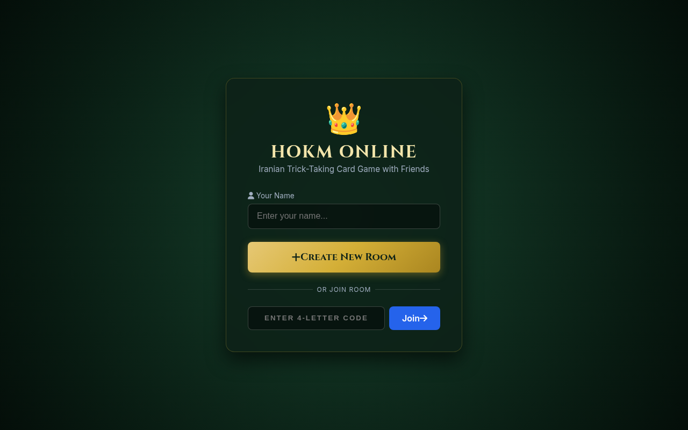
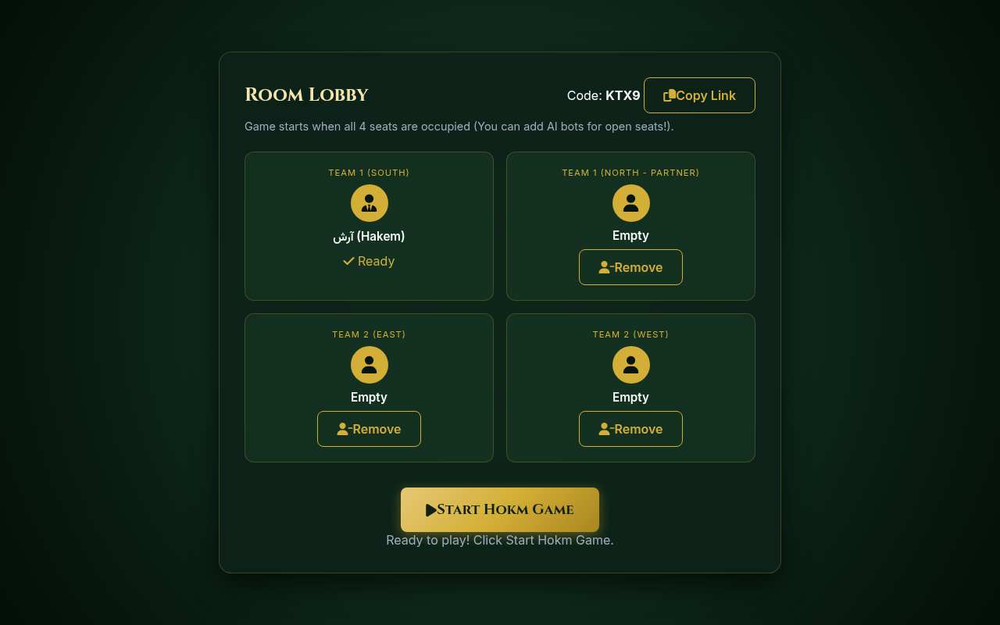

# 👑 Iranian Hokm (حکم) - Online 4-Player Card Game

A full-featured, real-time web application for playing the traditional **Iranian Hokm (حکم)** card game with friends or intelligent AI bots. Built with Node.js, Express, Socket.IO, and a responsive dark velvet poker table UI.

---

## 📸 Screenshots

| Landing & Room Creation | Room Lobby & AI Bots |
| :---: | :---: |
|  |  |

---

## ✨ Features

- **🎮 Full Hokm Game Engine**:
  - **Hakem Cutting**: Automated card cutting round to determine the first Hakem (👑).
  - **Trump Declaration**: 5-card modal prompt allowing the Hakem to select the trump suit (*Hokm*).
  - **Full Card Dealing**: 13 cards per player (dealt in standard $5 + 4 + 4$ sequence).
  - **Strict Rule Enforcement**: Mandatory suit-following, trumping/ruffing, and legal discarding.
  - **Trick & Match Scoring**: First team to 7 tricks wins the hand; first team to 7 points wins the match.
  - **Special Rule Bonuses**:
    - **Kot (کت)**: $+2$ points (winning team holds opponent team to 0 tricks).
    - **Hakem Kot (حاکم کت)**: $+3$ points (defeating Hakem's team $7-0$).
    - **Bām (بام)**: $+3$ points (winning all 7 tricks of the hand).

- **🤖 AI Bot Integration**:
  - Host can instantly add or remove AI bots for empty seats.
  - Play solo against 3 bots or mix human players with AI.

- **🔗 Room Management & Instant Invite**:
  - Short 4-letter room codes.
  - 1-click shareable URLs (`http://your-domain.com/?room=ABCD`) for frictionless room joining.

- **🎨 Modern Dark Velvet UI & Sound**:
  - Premium dark emerald velvet poker table layout with glassmorphism panels.
  - Clear suit colors (♥️ Hearts, ♠️ Spades, ♦️ Diamonds, ♣️ Clubs) and active turn highlights.
  - Interactive Web Audio API sound effects for card placement, trick wins, trump calls, and victory fanfare.
  - Quick Persian chat chips (*"دست خوش! 👌"*, *"حکم چی داری؟ 🤔"*, *"ایول! 🔥"*).

---

## 🛠️ Tech Stack

- **Backend**: Node.js, Express, Socket.IO
- **Frontend**: Vanilla JavaScript (ES6+), HTML5, Custom CSS3
- **Audio**: Web Audio API (Synthesized & Dynamic audio effects)
- **Icons & Fonts**: FontAwesome 6, Google Fonts (*Cinzel*, *Vazirmatn*, *Inter*)

---

## 🚀 Quick Start

### Prerequisites

- [Node.js](https://nodejs.org/) (v16 or higher)
- npm (Node Package Manager)

### Installation

1. **Clone the repository**:
   ```bash
   git clone https://github.com/archroid/hokm.git
   cd hokm
   ```

2. **Install dependencies**:
   ```bash
   npm install
   ```

3. **Start the server**:
   ```bash
   npm start
   ```

4. **Access the application**:
   Open your browser and navigate to `http://localhost:3000`.

---

## 🌐 Local Network (LAN) & Cloud Deployment

### Playing on Local Network (Wi-Fi)

To play with friends on the same Wi-Fi network:
1. Find your local IP address:
   ```bash
   hostname -I
   ```
2. Share the IP with your friends: `http://192.168.x.x:3000`.

### Deploying to a VPS (DigitalOcean / AWS / Hetzner)

#### 1. Keep Server Running 24/7 with PM2
```bash
npm install -g pm2
pm2 start server.js --name "hokm-server"
pm2 save
pm2 startup
```

#### 2. Nginx Reverse Proxy & SSL Setup

Sample Nginx server block (`/etc/nginx/sites-available/hokm`):

```nginx
server {
    server_name hokm.yourdomain.com;

    location / {
        proxy_pass http://localhost:3000;
        proxy_http_version 1.1;
        proxy_set_header Upgrade $http_upgrade;
        proxy_set_header Connection "Upgrade";
        proxy_set_header Host $host;
    }
}
```

Enable site & obtain SSL certificate via Certbot:
```bash
sudo ln -s /etc/nginx/sites-available/hokm /etc/nginx/sites-enabled/
sudo nginx -t && sudo systemctl reload nginx
sudo certbot --nginx -d hokm.yourdomain.com
```

---

## 📁 Project Structure

```
hokm/
├── assets/              # Screenshot previews for documentation
│   ├── landing.png
│   └── lobby.png
├── game/
│   ├── engine.js        # Core Hokm rules, scoring, card dealing & AI logic
│   └── roomManager.js   # Room lifecycle, lobby state & Socket.IO event handlers
├── public/
│   ├── css/
│   │   └── style.css    # Dark velvet poker table design & glassmorphism styles
│   ├── js/
│   │   ├── app.js       # Client Socket.IO logic, UI updates & card interaction
│   │   └── sound.js     # Web Audio API sound generator
│   └── index.html       # Single-page application structure
├── server.js            # Node.js HTTP server & WebSocket initializer
├── package.json         # Project metadata & dependencies
└── README.md            # Documentation
```

---

## 📄 License

Distributed under the [MIT License](LICENSE).
